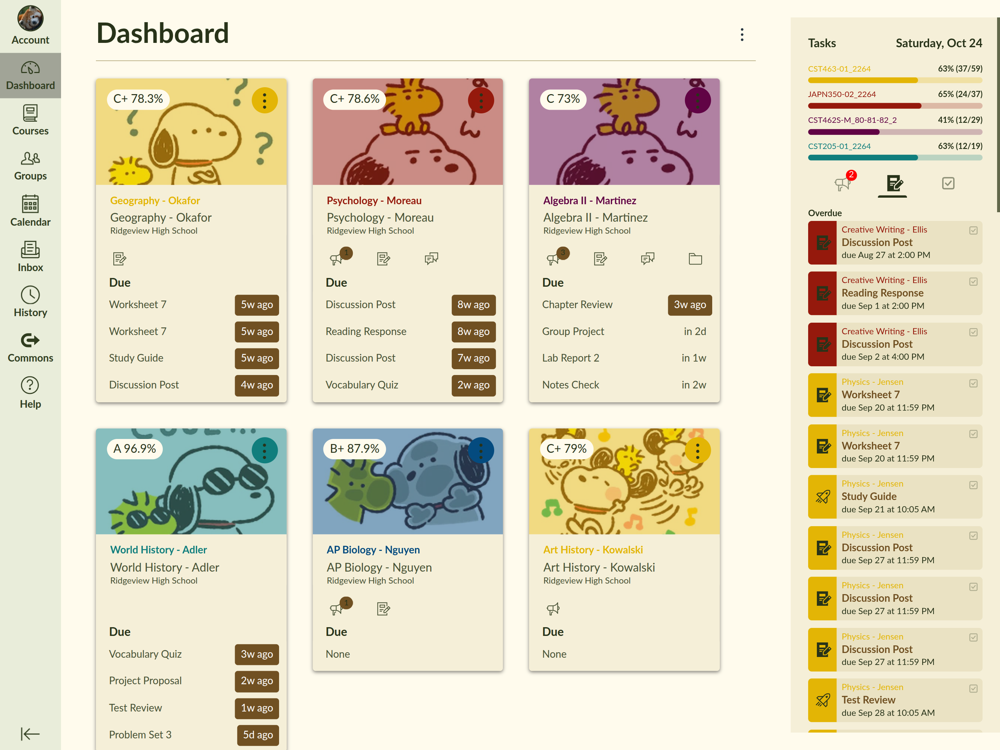

# Canvas Enhanced

Canvas LMS leaves much to be desired. The most popular extension providing additional features, BetterCampus (formerly BetterCanvas), is now closed-source, which is a security liability. [CanvasRefined](https://github.com/GuySandler/CanvasRefined), the leading alternative, is a fork of the last version of BetterCampus that was under an open-source license. CanvasRefined is good, but I made my own fork of it because I wanted something simple that matched my taste.



## Features

- Themes
	- Good built-in themes
	- Light/dark mode
	- Add custom themes
- Improved dashboard view
	- Show course grades
	- Overdue assignments shown for each class card
	- Custom styling of cards
- GPA calculator
- Grade analytics and history
- Quiz safe mode
- Canvas search for all courses/modules/assignments


## Canvas site access

The extension only loads on `https://*.instructure.com/*`. It declares no
all-sites host access, including optional permissions.

For a custom Canvas domain in a locally loaded copy, add its exact HTTPS match
pattern (for example, `https://canvas.school.edu/*`) to
`content_scripts[0].matches` in `manifest.json`, reload the extension, and
refresh Canvas. A settings-page option cannot extend the manifest's allowed sites.

## Notes

Compared to CanvasRefined, Canvas Enhanced reduces features and customization, opting for simplicity where possible.

It is recommended to use this with [Canvas Calendar Fix](https://canvas-calendar-fix.apps.edwinkofler.com/dashboard).

Current roadmap:

- Installable with userscript manager
- Fix issues with grade assignment hypo/simul
- Styling ux/styles can be improved a lot
- Other obvious fixes

## Packaging for extension stores

Run from any directory with Python 3 (no extra Python packages needed):

```sh
python3 scripts/package-extension.py
```

This creates the following in `dist/`, using the version in `manifest.json`:

- `canvas-enhanced-<version>-chrome.zip`: upload to the [Chrome Web Store Developer Dashboard](https://chrome.google.com/webstore/devconsole). Chrome Web Store requires a ZIP, not a CRX.
- `canvas-enhanced-<version>-firefox.xpi`: upload to [Firefox Add-ons](https://addons.mozilla.org/developers/). This is an unsigned ZIP-format XPI; Mozilla signs it after submission.

Only runtime files and the license are included; development files, screenshots,
keys, and previous packages are excluded. The source manifest is left unchanged.
Chrome's package omits Firefox-specific settings. Firefox's package uses background
scripts and requires Firefox 140+ to support its data collection declaration.

**Firefox identity:** the source manifest currently retains the upstream ID
`canvasrefined@guysan.site`. For a new Canvas Enhanced listing, choose your own
unique ID and keep it for all future uploads:

```sh
python3 scripts/package-extension.py --firefox-id 'canvas-enhanced@example.com'
```

Use your actual chosen ID rather than the example. For an existing listing, use
its assigned ID. You can instead update the ID in `manifest.json` permanently.
Before submitting, check that the manifest's `data_collection_permissions`
declaration accurately describes the extension's behavior.

Select one browser with `--target chrome` or `--target firefox`, or change the
output directory with `--output-dir /path/to/output`. Increment the manifest
version before uploading an update. The JavaScript is packaged as readable
source without a compilation/minification step, so no separate build-source
archive is normally needed for Firefox review. Mozilla may request additional
review information. Store descriptions, screenshots, privacy disclosures, and
account setup are completed in each store dashboard.

### Optional CRX for self-distribution

Chrome/Chromium is needed only for CRX generation. Create a private signing key
once (requires OpenSSL), keep it private, and reuse it to retain the same CRX ID:

```sh
# Run once; do not overwrite an existing signing key.
openssl genrsa -out canvas-enhanced.pem 2048
chmod 600 canvas-enhanced.pem
python3 scripts/package-extension.py --target chrome --crx --key canvas-enhanced.pem
```

This produces both the store ZIP and a signed `.crx`. Use `--chrome /path/to/chrome`
if the executable is not found automatically. Local CRX installation is subject
to Chrome's distribution restrictions; use the ZIP for the store upload. Signing
keys, CRXs, and the `dist/` directory are ignored by Git.
