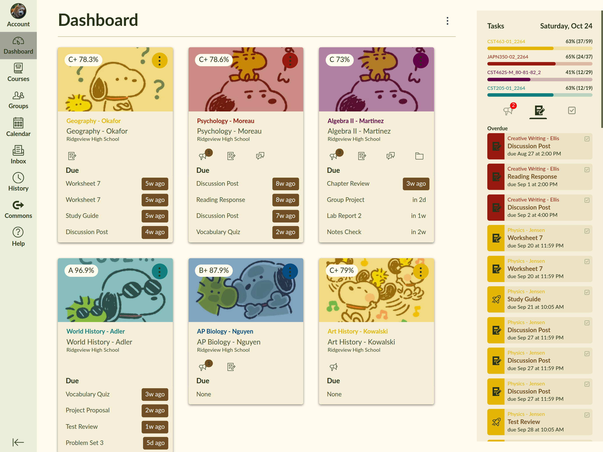

# Canvas Enhanced

Canvas LMS leaves much to be desired. The most popular extension providing additional features, BetterCampus (formerly BetterCanvas), has been closed-source, which is a security liability. I thought that [CanvasRefined](https://github.com/GuySandler/CanvasRefined), the leading open-source alternative, was good, but could have a much better user experience. So, I made Canvas Enhanced.

## Features

- Themes
  - Great built-in themes
  - Has light/dark mode
  - Add custom themes
- Improved dashboard view
  - Shows course grades
  - Shhows overdue assignments shown for each class card
  - Customize card styles
- GPA calculator
- Grade analytics and history
- Canvas search for all courses/modules/assignments

## Notes

Compared to CanvasRefined, Canvas Enhanced has much fewer features and customization options. It opts for simplicity where possible.

It is recommended to use this with [Canvas Calendar Fix](https://canvas-calendar-fix.apps.edwinkofler.com/dashboard).
